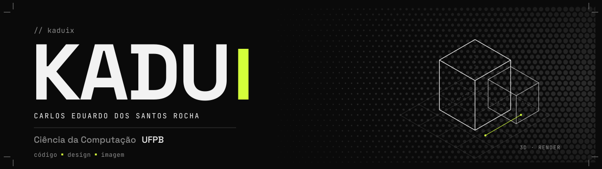
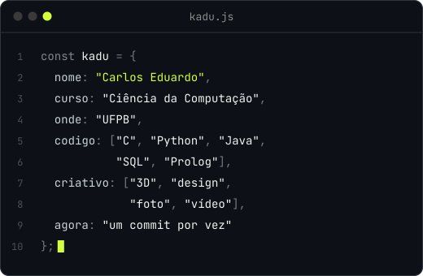
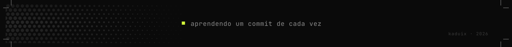

  

  
  
  

 

### `01` &nbsp;Sobre mim

<table>
  <tr>
    <td width="52%" valign="top">
      
    </td>
    <td width="48%" valign="top">

**Oi, eu sou o Kadu.**

Estudo **Ciência da Computação na UFPB** e gosto de entender como as coisas funcionam por baixo: da microarquitetura de um processador até a modelagem de um banco de dados.

Fora do código, trabalho com **projetos arquitetônicos e renderização 3D**, **design gráfico**, **edição de foto e vídeo** e **fotografia**. Meu jeito de programar vem muito daí: cuidado com estrutura, detalhe e com o resultado que a pessoa vê.

▸ Aqui ficam os projetos da faculdade e os pessoais 
▸ Aberto a projetos, estágio e trocas de ideia 
▸ Contato: **kadurochasantos@gmail.com**

  </td>
  </tr>
</table>

 

### `02` &nbsp;Stack

   
  

  
  
  

  LADO CRIATIVO 
  
  
  
  

 

### `03` &nbsp;Projetos

<table>
  <tr>
    <td width="50%" valign="top">
      <h4><a href="https://github.com/kaduix/recomendador-cursos-ufpb">Recomendador de Cursos UFPB</a></h4>
      Busca e recomendação de cursos da UFPB. Interface web em Flask e base de conhecimento em Prolog, que ranqueia os cursos pelos interesses da pessoa e compara dois cursos lado a lado.  
      
      
      
    </td>
    <td width="50%" valign="top">
      <h4><a href="https://github.com/Pedro15FNM/Projeto_Arquitetura2">Mic-1 / IJVM</a></h4>
      Máquina Mic-1 modificada que lê instruções IJVM, traduz cada uma em microinstruções de 23 bits e gera um log completo de registradores, memória e flags.  
      
      
      
    </td>
  </tr>
  <tr>
    <td width="50%" valign="top">
      <h4><a href="https://github.com/PedroMaxDEV/Projeto--PowerByte">PowerByte</a></h4>
      E-commerce via terminal feito com POO. Fiquei com a integração de banco de dados: persistência em SQLite, transações com commit e rollback e relatório de vendas.  
      
      
      
    </td>
    <td width="50%" valign="top">
      <h4>Em breve</h4>
      ▸ Estruturas de dados em C 
      ▸ Modelo de banco para e-commerce em MySQL 
      ▸ Calculadora de frete em JavaScript  
      Organizando e publicando aos poucos.
    </td>
  </tr>
</table>

 

### `04` &nbsp;Atividade

  
  

  

  <picture>
    <source media="(prefers-color-scheme: dark)" srcset="https://raw.githubusercontent.com/kaduix/kaduix/output/snake-dark.svg">
    <source media="(prefers-color-scheme: light)" srcset="https://raw.githubusercontent.com/kaduix/kaduix/output/snake.svg">
    
  </picture>

 

